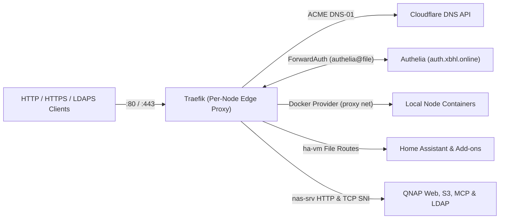

# Traefik

> Version: `v3.7.18` | Image: `ghcr.io/traefik/traefik:v3.7.18` | Upstream: https://github.com/traefik/traefik

Distributed edge router and reverse proxy deployed across 7 homelab hosts from a shared base (`src/shared`) overlaid with per-node dynamic routing rules (`src/nodes/<node>`).

## Overview

| Property | Value |
| :--- | :--- |
| **Domain** | `https://<node>.proxy.intranet.xbhl.online` (`media`, `infrastructure`, `dns`, `cloud`, `ha`, `code`, `nas`) |
| **Node** | 6 Proxmox VMs (`*.vm.xbhl.intranet`) + QNAP NAS (`nas.srv.xbhl.intranet`) |
| **Ingress** | Host-IP `:80`/`:443` binding (`web` -> `websecure` redirect) with Let's Encrypt Cloudflare DNS-01 TLS |
| **Authentication** | Intranet-only dashboards (`api@internal`); exports shared `authelia@file` ForwardAuth middleware |
| **Ecosystem** | WUD (`wud.watch=true`), Gatus (`src/config/traefik.yaml` across all 7 nodes); not in Homepage |

## Architecture & Key Decisions

- **Decentralized Per-Node Edge Routing**: Deployed independently onto 6 Proxmox VMs (`media`, `infrastructure`, `dns`, `cloud`, `ha`, `code`) and QNAP NAS (`nas`) by merging `src/shared` with `src/nodes/<node>`, binding `:80`/`:443` directly to each host's LAN IP so traffic terminates locally without cross-node hair-pinning.
- **Opt-In Container & Static Host Discovery**: Discovers local workloads via the read-only local Docker socket provider (`exposedByDefault: false` on the external `proxy` network), while `src/nodes/ha` and `src/nodes/nas` layer file-provider HTTP and TCP `HostSNI` routes (paired with `.gitlab-ci.yml`'s `update-additional-dns-records` Cloudflare DNS matrix job for non-Docker QNAP endpoints).
- **Wildcard DNS-01 TLS & CI Staging Guard**: Terminates TLS on `websecure` using node-local Let's Encrypt certificates via Cloudflare DNS-01 covering `xbhl.online` and wildcard intranet SAN scopes (`src/shared/static-config/traefik.yml` and `src/shared/dynamic-config/tls.yml`), automatically rewritten to `letsencrypt_stg` during DinD `test` jobs by `scripts/update_cert_resolver.sh`.
- **Shared ForwardAuth & Proxy Middleware**: Publishes a reusable `authelia@file` ForwardAuth middleware (`src/shared/dynamic-config/authelia.yml`) forwarding identity headers from `auth.xbhl.online` to downstream routers, alongside per-node `api@internal` dashboards (`api.insecure: false`) and `home-assistant-core-headers` proxy headers on `ha`.

## Upgrades & Maintenance

- **Upstream & Wrapper Sources**: Official `ghcr.io/traefik/traefik` image, [Traefik v3 migration guide](https://doc.traefik.io/traefik/migrate/v3/), and the `query-modification` plugin (`github.com/kingjan1999/traefik-plugin-query-modification`) pinned in `src/shared/static-config/traefik.yml` (not tracked by WUD).
- **Version & Flavor Constraints**: Release `vX.Y.Z` tags only (`wud.tag.include=^v\d+\.\d+\.\d+$$`, excluding pre-releases without locking major track `v3`); image must retain `wget` for the internal `http://localhost:8080/ping` healthcheck.
- **Intentional Choices (Do Not Propose)**: Keep the single-repo 7-node `src/shared` + `src/nodes/<node>` topology, direct read-only Docker socket discovery (`exposedByDefault: false`), node-local ACME storage (never shared over NFS), unauthenticated intranet `<node>.proxy.intranet.xbhl.online` dashboards, and reserved unpublished MQTT entryPoints/commented routers in `traefik.yml` and `home-assistant.yml`.
- **Upgrade & CI Gotchas**: Preserve `${VM_IP:-0.0.0.0}` port fallbacks in `src/shared/docker-compose.yml` (`VM_IP` is injected only during `deploy-files`, not DinD `test` jobs), keep wildcard SAN lists aligned between `traefik.yml` and `tls.yml`, and register any new file setting an explicit `certResolver`/`resolver` in `.gitlab-ci.yml` `default.before_script` (`scripts/update_cert_resolver.sh`) to avoid 7x parallel Let's Encrypt production rate limits in CI.
