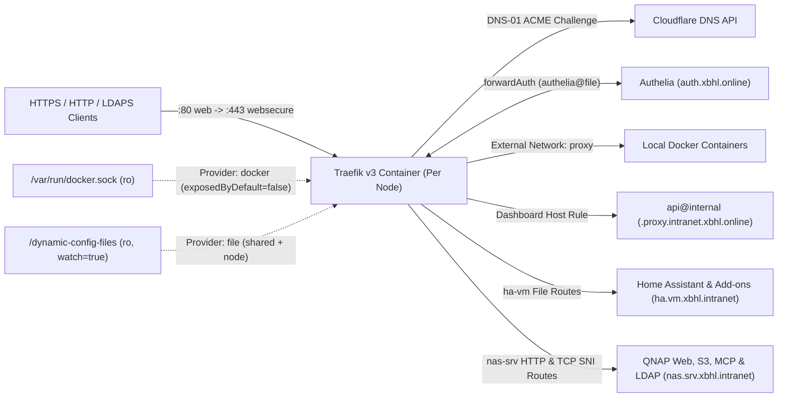

# Traefik

> Version: `v3.7.18` | Image: `ghcr.io/traefik/traefik:v3.7.18` | Upstream: https://github.com/traefik/traefik

Distributed edge router and reverse proxy deployed across 7 homelab nodes (6 Proxmox VMs and 1 QNAP NAS) from a shared Docker Compose base (`src/shared`) overlaid with node-specific dynamic configurations (`src/nodes/<node>`).

## Service Overview

| Property | Value |
| :--- | :--- |
| **Domain** | `https://<node>.proxy.intranet.xbhl.online` (`media`, `infrastructure`, `dns`, `cloud`, `ha`, `code`, `nas`) |
| **Primary Node** | 6 Proxmox VMs (`*.vm.xbhl.intranet`) + `nas.srv.xbhl.intranet` (QNAP NAS) |
| **Deploy Path** | `/opt/containers/traefik` (Proxmox VMs) / `/share/Container/services/traefik` (QNAP NAS) |
| **Ingress Strategy** | Direct Host IP Binding (`${VM_IP:-0.0.0.0}:80:80`, `${VM_IP:-0.0.0.0}:443:443`) + Let's Encrypt Cloudflare DNS-01 TLS |
| **Topology Archetype** | Distributed Per-Node Reverse Proxy (`src/shared` + `src/nodes/<node>`) |
| **Authentication** | None on intranet `<node>.proxy.intranet.xbhl.online` dashboards (`api@internal`, `api.insecure: false`); provides shared `authelia@file` `forwardAuth` middleware (`https://auth.xbhl.online/api/verify`) for downstream routers |
| **Ecosystem** | **WUD** (`wud.watch=true` in `src/shared/docker-compose.yml`); **Gatus** (`src/config/traefik.yaml` monitoring all 7 `/api/overview` and `:2375` container endpoints); **Homepage** (not registered) |

## Architecture & Communication

### 7-Node Fleet Inventory

Each pipeline run deploys `src/shared` (`delete-existing-container-files: true`) merged with `src/nodes/<node>` via `docker-compose-service-deployment`:

| Node Key | CI Service Name | Target Host | Deploy Path | Dashboard Endpoint | Node Dynamic Config (`src/nodes/<node>/dynamic-config/`) |
| :--- | :--- | :--- | :--- | :--- | :--- |
| `media` | `traefik:media-vm` | `media.vm.xbhl.intranet` | `/opt/containers/traefik` | `https://media.proxy.intranet.xbhl.online` | `traefik-dashboard.yml` |
| `infrastructure` | `traefik:infrastructure-vm` | `infrastructure.vm.xbhl.intranet` | `/opt/containers/traefik` | `https://infrastructure.proxy.intranet.xbhl.online` | `traefik-dashboard.yml` |
| `dns` | `traefik:dns-vm` | `dns.vm.xbhl.intranet` | `/opt/containers/traefik` | `https://dns.proxy.intranet.xbhl.online` | `traefik-dashboard.yml` |
| `cloud` | `traefik:cloud-vm` | `cloud.vm.xbhl.intranet` | `/opt/containers/traefik` | `https://cloud.proxy.intranet.xbhl.online` | `traefik-dashboard.yml` |
| `ha` | `traefik:ha-vm` | `ha.vm.xbhl.intranet` | `/opt/containers/traefik` | `https://ha.proxy.intranet.xbhl.online` | `traefik-dashboard.yml`, `home-assistant.yml` |
| `code` | `traefik:code-vm` | `code.vm.xbhl.intranet` | `/opt/containers/traefik` | `https://code.proxy.intranet.xbhl.online` | `traefik-dashboard.yml` |
| `nas` | `traefik:nas-srv` | `nas.srv.xbhl.intranet` | `/share/Container/services/traefik` | `https://nas.proxy.intranet.xbhl.online` | `traefik-dashboard.yml`, `nas.yml` |

### EntryPoints, Wildcard TLS & Runtime Layout

- **EntryPoints (`src/shared/static-config/traefik.yml`)**: `web` (`:80`, permanent HTTP-to-HTTPS redirect to `websecure` at priority `10000`) and `websecure` (`:443`, `readTimeout: 3600`), published on the host interface via `${VM_IP:-0.0.0.0}:80:80` and `${VM_IP:-0.0.0.0}:443:443`. Static config also defines unpublished MQTT entryPoints (`mqtt` `:1883`, `mqtts` `:8883`, `mqtt-webockets` `:9002`).
- **Wildcard Let's Encrypt DNS-01 SANs**: `websecure` (`certResolver: letsencrypt_prod`) requests main domain `xbhl.online` with SANs `*.xbhl.online`, `*.intranet.xbhl.online`, `*.nas.intranet.xbhl.online`, `*.ha.intranet.xbhl.online`, `*.ai.intranet.xbhl.online`, `*.proxy.intranet.xbhl.online`, and `*.portainer.intranet.xbhl.online`. `src/shared/dynamic-config/tls.yml` configures `tls.stores.default.defaultGeneratedCert` (`resolver: "letsencrypt_prod"`) for `xbhl.online` and SANs `*.xbhl.online`, `*.intranet.xbhl.online`, `*.nas.intranet.xbhl.online`, `*.ha.intranet.xbhl.online`, `*.ai.intranet.xbhl.online`, and `*.proxy.intranet.xbhl.online`.
- **ACME Storage & Volumes (`src/shared/docker-compose.yml`)**: Cloudflare DNS-01 resolvers (`1.1.1.1:53`, `8.8.8.8:53`) persist certificates in the node-local `letsencrypt` volume (`/letsencrypt/acme.json` for `letsencrypt_prod`, `/letsencrypt/acme-stg.json` for `letsencrypt_stg`). `./static-config` and `./dynamic-config` are mounted read-only via bind-backed local named volumes (`static-config:/etc/traefik:ro`, `dynamic-config:/dynamic-config-files:ro`) alongside `/var/run/docker.sock:/var/run/docker.sock:ro` and `/etc/ssl/certs:/etc/ssl/certs:ro` (`serversTransport.insecureSkipVerify: false`).
- **Providers, Healthcheck & Plugins**: Enables `docker` (`exposedByDefault: false`, external network `proxy`), `file` (`/dynamic-config-files`, `watch: true`), internal healthcheck endpoint `ping: {}` (`wget --quiet --tries=1 --spider http://localhost:8080/ping`), and experimental plugin `query-modification` (`github.com/kingjan1999/traefik-plugin-query-modification`).
- **Shared `authelia@file` Middleware (`src/shared/dynamic-config/authelia.yml`)**: Exposes a reusable `forwardAuth` middleware on every node targeting `https://auth.xbhl.online/api/verify?rd=https%3A%2F%2Fauth.xbhl.online%2F` (`trustForwardHeader: true`) and forwarding `Remote-User`, `Remote-Groups`, `Remote-Name`, and `Remote-Email` headers.

### File-Provider Routes (`ha` & `nas`) & Custom DNS Automation

- **Home Assistant Node (`src/nodes/ha/dynamic-config/home-assistant.yml`)**: Proxies non-Docker/VM-local services on `websecure` (with explicit `certResolver: "letsencrypt_prod"`) to `ha.vm.xbhl.intranet`: `ha.intranet.xbhl.online` (`https://ha.vm.xbhl.intranet:8123` with `home-assistant-core-headers`), `zigbee2mqtt.ha.intranet.xbhl.online` (`:8125`), `nodered.ha.intranet.xbhl.online` (`:1880`), `esphome.ha.intranet.xbhl.online` (`:6052`), `vscode.ha.intranet.xbhl.online` (`:8443`), `glances.ha.intranet.xbhl.online` (`:61208`), and `pgadmin.ha.intranet.xbhl.online` (`:8080`).
- **QNAP NAS Node (`src/nodes/nas/dynamic-config/nas.yml`)**: Proxies `nas.intranet.xbhl.online` (`http://nas.srv.xbhl.intranet:8080`), redirects `nas.xbhl.online` -> `https://nas.intranet.xbhl.online/${1}` (`noop@internal`), routes `s3.intranet.xbhl.online` and `objectstorage.nas.intranet.xbhl.online` (`http://nas.srv.xbhl.intranet:8010`), routes `mcp.nas.intranet.xbhl.online` (`http://nas.srv.xbhl.intranet:8442/mcp`), and terminates TLS via TCP `HostSNI(\`ldap.intranet.xbhl.online\`)` on `websecure` (`tls: {}`) -> `nas.srv.xbhl.intranet:389`.
- **NAS Cloudflare DNS Matrix Job**: On `main`, `deploy:traefik:nas-srv:update-additional-dns-records` runs after `deploy:traefik:nas-srv:start-service` and `deploy:traefik:nas-srv:resolve-host-ip` to create/update Cloudflare DNS records for `nas.xbhl.online`, `nas.intranet.xbhl.online`, `objectstorage.nas.intranet.xbhl.online`, `s3.intranet.xbhl.online`, `ldap.intranet.xbhl.online`, and `mcp.nas.intranet.xbhl.online`.
- **DinD `test` Stage Staging Override**: When `$CI_JOB_STAGE == "test"`, `default.before_script` executes `./scripts/update_cert_resolver.sh` to rewrite `letsencrypt_prod` -> `letsencrypt_stg` in `src/shared/static-config/traefik.yml`, `src/nodes/ha/dynamic-config/home-assistant.yml`, and `src/shared/dynamic-config/tls.yml` before DinD startup validation. `setup:generate-build-artifacts` writes the Cloudflare variables to `$BUILD_ARTIFACTS_DIR/.env`, while each `deploy:traefik:<node>:deploy-files` job resolves and appends `VM_IP=$VM_IP` only during deployment.

## Required GitLab CI/CD Variables

All 5 variables are inherited from the `home-lab` GitLab group (`VM_IP` is resolved dynamically per target host during `deploy-files` and is not configured as a CI/CD variable):

| Variable | Consumer | Purpose |
| :--- | :--- | :--- |
| `SSH_USER` | `.gitlab-ci.yml` (`vm-ssh-username`) | SSH account used to deploy files and manage Docker Compose across all 7 nodes |
| `SSH_PRIVATE_KEY` | `.gitlab-ci.yml` (`vm-ssh-private-key`) | SSH private key for authenticating to the 6 Proxmox VMs and QNAP NAS |
| `CLOUDFLARE_ZONE_ID` | `.gitlab-ci.yml` (`cloudflare-zone-id`, `CF_ZONE_ID`, `.env`) | Cloudflare Zone ID for `xbhl.online` DNS record synchronization and container `.env` |
| `CLOUDFLARE_DNS_API_TOKEN` | `.gitlab-ci.yml` & `src/shared/docker-compose.yml` | Cloudflare DNS edit token for CI DNS record updates and Traefik ACME DNS-01 challenges |
| `CLOUDFLARE_ZONE_API_TOKEN` | `.gitlab-ci.yml` (`.env`) & `src/shared/docker-compose.yml` | Cloudflare Zone read token required by Traefik (`${CLOUDFLARE_ZONE_API_TOKEN:?err}`) for ACME DNS-01 zone lookup |

## Upgrades & Maintenance

- **Upstream & Wrapper Sources**: Standard (`ghcr.io/traefik/traefik` tracked via `wud.link.template`); Traefik v3 migration & breaking-changes guide: <https://doc.traefik.io/traefik/migrate/v3/>; experimental plugin `query-modification` (<https://github.com/kingjan1999/traefik-plugin-query-modification>, pinned in `src/shared/static-config/traefik.yml` and not tracked by WUD).
- **Version & Flavor Constraints**: Release `vX.Y.Z` tags only (`wud.tag.include=^v\d+\.\d+\.\d+$$`, excluding RC/experimental suffixes; regex does not lock major track `v3`); image must retain `wget` for the `http://localhost:8080/ping` healthcheck in `src/shared/docker-compose.yml` (`ping: {}` in `src/shared/static-config/traefik.yml`).
- **Intentional Choices (Do Not Propose)**: Single-repo 7-node deployment (`src/shared` + `src/nodes/{media,infrastructure,dns,cloud,ha,code,nas}` with `delete-existing-container-files: true`); direct `/var/run/docker.sock:ro` (`exposedByDefault: false`) and `/etc/ssl/certs:ro` mounts, `${VM_IP:-0.0.0.0}:80/:443` host-IP binding, and local `letsencrypt` named volume (not NFS); intranet dashboard routers (`<node>.proxy.intranet.xbhl.online` -> `api@internal` without `authelia` middleware); file-provider routes + `deploy:traefik:nas-srv:update-additional-dns-records` DNS matrix job for non-Docker `ha`/`nas` services, plus unpublished MQTT entryPoints (`mqtt`/`mqtts`/`mqtt-webockets` in `traefik.yml`) and commented-out external/MQTT routers in `home-assistant.yml`.
- **Upgrade & CI Gotchas**: Compose file lives at `src/shared/docker-compose.yml` with `driver: local` (`o: bind`) volumes for `./static-config` and `./dynamic-config`, and requires the `:-0.0.0.0` fallback in `${VM_IP:-0.0.0.0}` because `VM_IP` is only appended to `$BUILD_ARTIFACTS_DIR/.env` during `deploy:traefik:<node>:deploy-files` (absent in DinD `test` jobs); `.gitlab-ci.yml` relies on `default.before_script` inheritance in `test` jobs to run `./scripts/update_cert_resolver.sh` (`letsencrypt_prod` -> `letsencrypt_stg` across `traefik.yml`, `tls.yml`, and `home-assistant.yml`—any new file setting explicit `certResolver`/`resolver` must be added there to prevent 7x parallel Let's Encrypt prod rate-limit hits) and directly `!reference`s internal CI template anchors (`.ssh-job-base:traefik:<node>`, `.base:image:alpine`, `.base:dns:cloudflare:*`).
